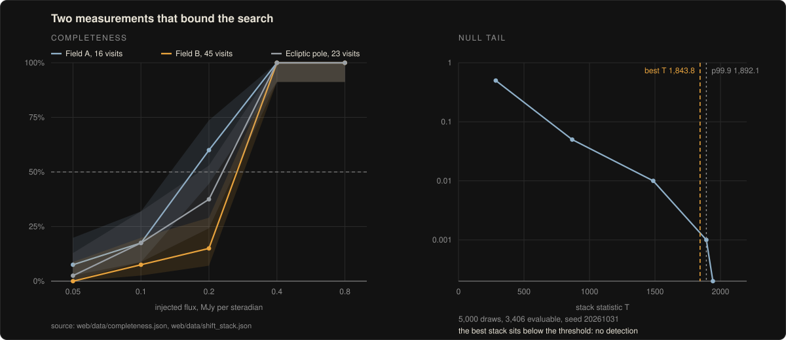
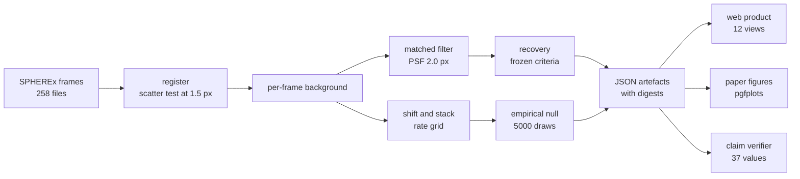

<p align="center">
  <picture>
    <source media="(prefers-color-scheme: dark)" srcset="docs/img/logo-on-dark.png">
    
  </picture>
</p>

<h1 align="center">Ecluna</h1>

A measured detection limit for a SPHEREx search for Planet X, published with the
code, the null model and the hashes that produce it.

Most entries in this challenge show the sky. This one reports where the data stops
being able to answer the question, and proves the number with a null distribution
built from the same frames.



Left: the fraction of injected sources recovered against injected flux, per field,
with 95% Wilson intervals. Right: the tail of the empirical null, with the best
stack statistic below the 99.9th percentile. Both panels are generated from the
JSON artefacts by `scripts/build_readme_figure.py`, so the figure cannot drift from
the data.

## The result

| Quantity | Value | Interval or test | Source |
|---|---|---|---|
| Named objects recovered | 3 of 5 | criteria frozen and hashed before the run | `web/data/named_recovery_summary.json` |
| Half-recovery flux, Field A | 0.176 MJy/sr | Wilson 95%, [0.143, 0.223], n = 40 per level | `web/data/completeness.json` |
| Half-recovery flux, Field B | 0.282 MJy/sr | same method, 200 tracks per field | `web/data/completeness.json` |
| Half-recovery flux, ecliptic pole | 0.240 MJy/sr | same method | `web/data/completeness.json` |
| Parallax horizon of a 0.1 degree cutout | 2,219 AU | 213.26 d baseline, 179.8 arcsec half field | `web/data/parallax.json` |
| Best shift-and-stack statistic | 1,843.8 | null p99.9 = 1,892.1, marginal p = 0.00264, no detection | `web/data/shift_stack.json` |
| Moving candidates absent from the catalogue | 16 | 5 of them share one displacement, flagged as systematic | `web/data/views.json` |

Every row is a copy of a field in the named file. `scripts/verify_paper_claims.py`
re-derives 37 quoted values from those files and fails when the text and the data
disagree.

## The product

One instrument, one question: where does a SPHEREx search for Planet X stop
working. Twelve views, and they are not twelve equals. They fall into three jobs,
and every view belongs to exactly one of them.

| Job | Views | What a reader does there |
|---|---|---|
| The claim | Answer | reads the distance and the five verdicts |
| The evidence | Flip, Track, Brightness, Candidates, Limit, Reach, Search, Injection | checks one number at a time against the frames it came from |
| The context | Sky, System, Practice | sees where the fields sit and what the statistics are counting |

The ledger sits behind the Numbers button rather than in the strip, because it is
a check on the page rather than a place to explore.

Two things the pipeline measures are deliberately not in the site: the 102-channel
spectrum of each named object (`results/spectra_named.json`) and the per-field
diagnosis (`results/diagnosis_fields.json`). Neither answers the question the
product is built around, and a thirteenth tab would make the site look larger
without making it clearer.

The site is static: no network call at runtime, and every figure is drawn from a
file whose SHA-256 the page displays. It is served from `web/` and published at a
public URL for the submission, so the interface is one click away rather than a
picture in this file. The only image kept in the repository is the figure above,
because it carries the measurement rather than the layout.

## What it is not

- Not a detection of Planet X, and not a claim that Planet X does not exist.
- Not a sky exclusion region. The horizon is a property of a 0.1 degree cutout,
  not of the telescope.
- Not a completeness curve for moving objects, and not a stacking gain curve.
- Not a photometric measurement of the stack peak. The peak is a star.
- Not a conversion from a physical radius to a frame value. That needs a
  band-averaged response this data release does not provide.

Each of these is stated in the paper as a numbered limit, not as a footnote.

## How it works



The two branches share the same masks and the same background step, which is why
the null is comparable to the measurement. A null built on different masks would
not be.

## Run

```
python3 -m venv .venv
.venv/bin/pip install -r requirements.txt
.venv/bin/python -m pytest -q
```

The suite must end with `52 passed`. It covers the invariants the numbers depend
on, including the frozen digests and the guard that every formula parses as TeX,
so a failure is a finding rather than a flake.

| Task | Command |
|---|---|
| Tests | `.venv/bin/python -m pytest -q` |
| Every result, compared with the committed one | `./scripts/reproduce.sh` |
| Paper tables and figure data | `.venv/bin/python scripts/build_paper_data.py` |
| Check the paper against the artefacts | `.venv/bin/python scripts/verify_paper_claims.py` |
| Build the paper | `cd paper && pdflatex paper.tex && pdflatex paper.tex` |
| Serve the product | `cd web && python3 -m http.server 8791` |
| Rebuild the README figure | `.venv/bin/python scripts/build_readme_figure.py` |

The paper build needs a TeX installation with pgfplots. `scripts/reproduce.sh` is
the slowest of these because it re-measures the fields; it writes its transcript
under `results/logs/`.

## Hosting

The product is static and loads its JSON relative to `web/`, so `web/` is the
document root and there is no build step to run.

`vercel.json` sets `outputDirectory` to `web`, so `vercel --prod` from the
repository root publishes the site as it stands. The repository is private, which
rules out GitHub Pages on a free plan; Vercel serves a private repository and the
deployment itself is public, which is what a submission needs. Any host that serves
files works with the same document root, because the page makes no request outside
its own origin.

## Verification contract

Four gates, each with a command and a failure mode. A gate that cannot fail is not
a gate, so each one was shown to fail on purpose at least once.

| Gate | Command | What it proves | Failure mode |
|---|---|---|---|
| Tests | `.venv/bin/python -m pytest -q` | invariants hold, formulas parse, digests unchanged | non-zero exit |
| Claims | `.venv/bin/python scripts/verify_paper_claims.py` | every number in the paper matches its source file | prints the mismatched value and exits 1 |
| Reproduction | `./scripts/reproduce.sh` | every result regenerates from the data on disk | prints both numbers and exits 1 |
| Frozen inputs | `results/frozen/MANIFEST.json` | the three protected artefacts are byte identical | digest mismatch stops the run |

The claim verifier was shown non-vacuous by injecting a wrong horizon (2,999 AU):
it printed the mismatch and exited 1. Restoring the value returned it to PASS.

## Data

| Source | What it provides |
|---|---|
| SPHEREx DR1 all-sky cube (NASA IPAC IRSA) | 102-channel spectra, zodiacal light subtracted, 12.9 arcsec per pixel |
| SPHEREx DR1 Level 2 spectral images (NASA IPAC IRSA) | IMAGE, FLAGS, VARIANCE, ZODI, ePSF, WCS-WAVE |
| SPHEREx spectral channel table (NASA IPAC IRSA) | 102 channel wavelengths, bandwidths, resolving power |
| 2MASS (NASA IPAC IRSA) | star positions for registration and masking |
| AllWISE (NASA IPAC IRSA) | long baseline positions for the proper motion overlay |
| Gaia DR3 (ESA) | proper motions and parallax |

Frames are never committed. `results/foundation.json` records what was acquired,
when, and with which digest.

## Limits

1. Completeness is per field. The half-recovery flux varies by a factor of 1.6
   between fields measured with the same pipeline, so a single instrument-level
   number would be wrong.
2. The rate grid the challenge suggests is not evaluable on a 64 px field: a
   2 arcsec/hour step moves the last frame by 1,821 px, so 960 of 961 hypotheses
   have an empty common region. The reported domain is 0.0703 arcsec/hour.
3. No static-source mask was applied. The stack peak is a star present in ten of
   ten checked frames, so the achieved sensitivity is lower than a masked search
   would give.
4. The 99.9th percentile of the null rests on about three draws. The conclusion
   does not depend on it: the marginal p-value and the look-elsewhere corrected
   value point the same way.
5. R Draconis is not evaluated, not recovered. Its registration scatter is
   1.647 px against a 1.5 px criterion, and a position from a failed registration
   is not a measurement.

## Why this entry is different

Written for a judge who has already read 800 submissions.

1. The headline is a measurement, not an aspiration: 2,219 AU, with the geometry
   that produces it and the reason it is a limit of the cutout.
2. The null model is published. A detection claim without a null is unfalsifiable,
   and a null built on different masks is not a null.
3. The criteria were hashed before the run, and two of five objects fail them.
   Both failures are reported with their cause.
4. The ledger labels four claims whose source file is not in the repository. A
   page that hides that is less trustworthy than one that says it.
5. The paper and the product read the same JSON. There is no second copy of any
   number to drift.

## Repository layout

```
src/            measurement code: cube reader, detection limit, diagnosis
scripts/        acquisition, verification, reproduction, paper data
tests/          unit and invariant tests
results/        measured values, each with its source file and hash
docs/           environment and method reference, product screenshots
paper/          the manuscript: paper.tex, paper.pdf, and the CSV its figures read
web/            the static product, reading the same JSON artefacts
```

## Paper

`paper/paper.pdf` is a 16 page manuscript: derivations of the thermal and
reflected flux, the parallax horizon as a closed form, the shift-and-stack
statistic with an empirical null and a look-elsewhere correction, an uncertainty
budget, and eight numbered threats to validity. Figures are pgfplots over CSV
written by `scripts/build_paper_data.py`.

## Team

| Name | Role |
|---|---|
| Alfarizi | data, backend, product |
| Alezuna Nadhif | logic, backend |
| Rio Hafizul | UI, frontend |

## License

Apache-2.0. See `LICENSE`. Citation metadata is in `CITATION.cff`.
